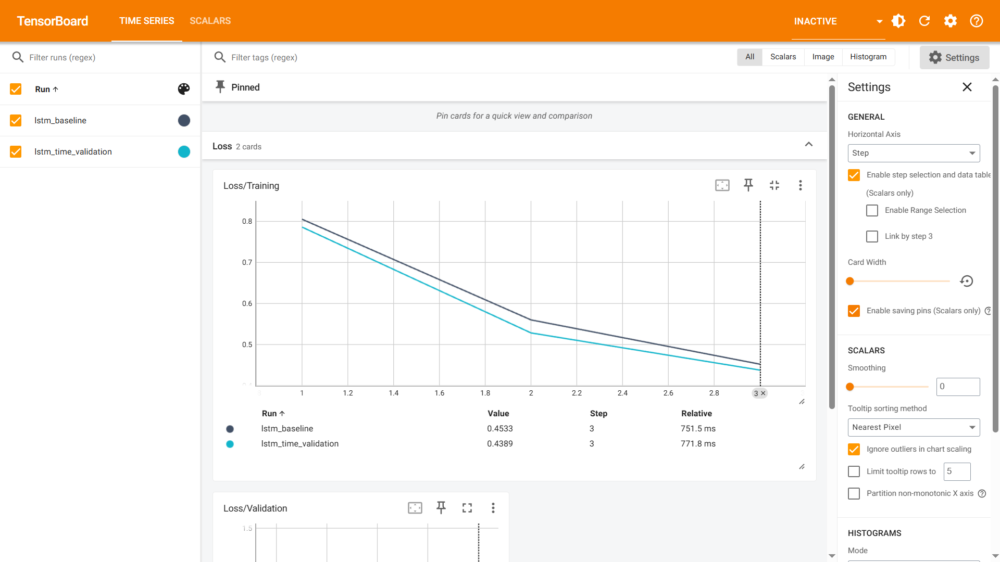

# FactoryPulse AI

### Industrial Condition Monitoring & Intelligent Maintenance

**Python · PyTorch · LSTM Autoencoder · Industrial Time Series · TensorBoard · Anomaly Detection Research**

FactoryPulse AI is a hands-on industrial AI engineering project exploring condition monitoring and anomaly detection using real-world air-compressor sensor data. It covers the workflow from data ingestion and time-aware preprocessing to neural-network training, reconstruction-error analysis, and experiment tracking.

The project uses the **MetroPT-3 Air Compressor dataset**. Its long-term goal is to evolve into a practical industrial monitoring application with an inference API, data streaming, a dashboard, and cloud deployment.

> **Current status:** Data engineering, LSTM Autoencoder training, chronological validation, TensorBoard logging, and exploratory reconstruction-error scoring are implemented. **Anomaly thresholds and real-failure detection performance have not yet been validated.**

---

## 1. Project Objectives

- Ingest, validate, and process industrial sensor recordings.
- Handle irregular timestamps and gaps in time-series data.
- Generate valid multivariate sequences without crossing recording discontinuities.
- Train a PyTorch LSTM Autoencoder to reconstruct sensor behavior.
- Track training and validation performance using TensorBoard.
- Investigate reconstruction errors as candidate anomaly scores.
- Eventually evaluate known failure events and integrate inference into an industrial monitoring application.

## 2. Dataset

**Dataset:** MetroPT-3 — Air Compressor Monitoring Data

| Property | Value |
|---|---|
| Total records | 1,516,948 |
| Processed columns | 19 |
| Recording period | February–September 2020 |
| Continuous recording segments | 332 |
| Selected model input sensors | 4 |
| Documented air-leak failure periods | 4 |

### Selected Sensors

| Sensor | Description |
|---|---|
| `Motor_current` | Electric motor current |
| `Oil_temperature` | Compressor oil temperature |
| `TP2` | Pressure measurement |
| `TP3` | Pressure measurement |

The original dataset also contains other analog and digital signals, which may support future analyses of operating states.

**Data availability:** The original CSV and generated Parquet dataset are not stored in Git. They must be obtained and prepared locally. See [Getting Started](#8-getting-started).

## 3. Data Engineering and Preprocessing

The pipeline in `scripts/prepare_data.py` and `src/factorypulse/ml/data_preparation.py` performs:

1. CSV ingestion, timestamp parsing, and chronological sorting.
2. Sensor missing-value checks.
3. Detection of timestamp gaps exceeding **60 seconds**, with `segment_id` assigned to contiguous recording intervals.
4. Chronological division into **70% training, 10% validation, and 20% test** partitions.
5. Exclusion of the documented failure intervals from the training and validation partitions.
6. `StandardScaler` fitting **only on the cleaned training partition**, followed by transformation of validation and test data.
7. Construction of valid rolling sequences without crossing segment boundaries, dataset partition boundaries, or removed-record gaps.

### Temporal Data Split

```text
Earlier data                                       Later data
|-----------------------|---------|-----------------------|
       Train 70%         Val 10%         Test 20%
   Learn model weights    Monitor         Reserve for
                         training        independent checks
```

The partitions are **not created by randomly shuffling raw rows**. This reduces the risk of leakage between overlapping sequences across different partitions.

> Removing known failures does not prove that all remaining sensor recordings are fault-free. The validation partition is treated as *nominal-data-oriented*, not guaranteed healthy ground truth.

The preprocessed dataset is stored locally as `data/processed/metropt3_processed.parquet`.

## 4. LSTM Autoencoder Architecture

FactoryPulse AI uses a reconstruction-based **LSTM Autoencoder** built in PyTorch.

```text
Multivariate sensor measurements
                |
                v
    Valid time-series sequences
      60 time steps × 4 sensors
                |
                v
           LSTM Encoder
         Hidden size: 32
                |
                v
       Latent representation
                |
                v
           LSTM Decoder
                |
                v
            Linear layer
                |
                v
     Reconstructed sequences
      60 time steps × 4 sensors
                |
                v
  Mean squared reconstruction error
                |
                v
  Candidate anomaly score (research)
```

A custom `CompressorSequenceDataset` generates windows on demand. Windows are constrained by both recording segments and the original row indices, so removed failure intervals cannot be silently joined into a single sequence.

Typical input batch shape: **`(32, 60, 4)`** — batch size, time steps, sensors.

## 5. Model Training and Evaluation

### Baseline Configuration

| Parameter | Configuration |
|---|---|
| Framework | PyTorch |
| Model | LSTM Autoencoder |
| Input features | 4 |
| Sequence length | 60 |
| Hidden size | 32 |
| Batch size | 32 |
| Optimizer | Adam |
| Learning rate | 0.001 |
| Loss function | Mean Squared Error (MSE) |
| Epochs | 3 |
| Sampled training sequences | 2,048 |
| Sampled validation sequences | Up to 512 |
| Random seed | 42 |
| Execution | CPU |

The small training subset keeps early experiments fast; it is **not** yet a fully tuned model trained on the entire available dataset.

### Historical Baseline: Training Loss

The first run used the earlier chronological **80% train / 20% test** setup, before introducing a separate validation partition.

| Epoch | Training MSE |
|---|---:|
| 1 | 0.805409 |
| 2 | 0.560894 |
| 3 | 0.453304 |

### Updated Experiment: Time-Aware Validation

After moving to the **70/10/20** split, validation loss is measured after each epoch on a separate, later time partition.

| Final metric (epoch 3) | MSE |
|---|---:|
| Training loss | **0.4389** |
| Validation loss | **0.6389** |

Both curves decreased during this three-epoch run. Validation error remained higher than training error, but the short experiment is insufficient to determine reliable generalization or fault-detection capability.

### TensorBoard: Experiment Monitoring

PyTorch's `SummaryWriter` logs `Loss/Training` and `Loss/Validation` under `runs/lstm_time_validation/`. TensorBoard presents these as charts and supports comparison with the earlier `lstm_baseline` run.



*Figure: TensorBoard screenshot from the local baseline experiment. These curves measure reconstruction error, not anomaly-detection accuracy.*

The `runs/` folder is excluded from Git. The figure above is a **static screenshot** stored separately under `docs/images/`.

### Exploratory Test Reconstruction Errors

`scripts/evaluate_lstm.py` loads the saved model checkpoint and training-fitted scaler, creates contiguous test sequences, evaluates up to **512** evenly spaced sequence indices, and prints summary statistics plus the ten highest-error timestamps.

An **earlier exploratory run** (before the 70/10/20 retraining) produced:

| Measurement | Value |
|---|---:|
| Valid test sequences | 299,701 |
| Sampled sequences scored | 512 |
| Mean reconstruction error | 0.511924 |
| Median reconstruction error | 0.430334 |
| Maximum reconstruction error | 1.732736 |

**These historical test scores are not directly comparable to the updated training/validation results.** The final chronological test partition does not contain any of the four documented failure periods. Therefore, current test scores cannot establish failure recall, precision, or a validated false-alarm rate.

**Current interpretation:** A high reconstruction error is a **candidate for further investigation**, not a confirmed machine failure.

## 6. Project Structure

```text
factorypulse-ai/
├── data/
│   ├── raw/                         # local data, ignored by Git
│   ├── interim/                     # local data, ignored by Git
│   └── processed/                   # local Parquet, ignored by Git
├── models/                          # local model/scaler, ignored by Git
├── runs/                            # local TensorBoard logs, ignored by Git
├── scripts/
│   ├── inspect_data.py
│   ├── prepare_data.py
│   ├── train_lstm.py
│   └── evaluate_lstm.py
├── src/
│   └── factorypulse/
│       ├── ingestion/
│       ├── validation/
│       │   └── data_validator.py
│       ├── ml/
│       │   ├── data_preparation.py
│       │   ├── sequence_dataset.py
│       │   └── lstm_autoencoder.py
│       ├── api/                      # planned / reserved
│       ├── database/                 # planned / reserved
│       ├── monitoring/               # planned / reserved
│       └── core/
├── tests/
│   └── test_data_validator.py
├── docs/
│   └── images/
│       └── tensorboard-training-validation.png
├── .gitignore
└── README.md
```

*Some folders are reserved for future functionality. The repository deliberately does not include the raw dataset, trained model binaries, or TensorBoard event logs.*

## 7. Technology Stack

| Area | Technologies |
|---|---|
| Programming | Python 3.12 |
| Data processing | Pandas, NumPy, Parquet |
| Scaling and preprocessing | Scikit-learn |
| Deep learning | PyTorch |
| Neural architecture | LSTM Autoencoder |
| Experiment tracking | TensorBoard / PyTorch SummaryWriter |
| Model persistence | PyTorch checkpoints, Joblib |
| Testing | Pytest |
| Version control | Git, GitHub |
| Development | PyCharm |

**Planned integrations:** FastAPI, MQTT, database storage, industrial dashboard, Docker, and Microsoft Azure.

## 8. Getting Started

### Clone and Create a Virtual Environment

```powershell
git clone https://github.com/amin-ghasemi-de/factorypulse-ai.git
cd factorypulse-ai
python -m venv .venv
.\.venv\Scripts\Activate.ps1
```

### Install Dependencies

CPU-based Windows environment used for the baseline:

```powershell
python -m pip install torch==2.8.0 --index-url https://download.pytorch.org/whl/cpu
python -m pip install pandas numpy scikit-learn pyarrow joblib pytest tensorboard
```

### Prepare the Dataset

Obtain the MetroPT-3 dataset separately and place its CSV at:

```text
data/raw/MetroPT3(AirCompressor).csv
```

Then run:

```powershell
python scripts/prepare_data.py
```

Expected local output:

```text
data/processed/metropt3_processed.parquet
```

### Train the LSTM Autoencoder

```powershell
$env:PYTHONPATH="src"
python scripts/train_lstm.py
```

This regenerates chronological training/validation datasets, trains the baseline, logs loss values, and saves local model artifacts to `models/`.

### Open TensorBoard

```powershell
tensorboard --logdir=runs
```

Open **http://localhost:6006** and select `lstm_time_validation` to view the training and validation curves.

### Explore Test Reconstruction Errors

Run this after training so the saved model and scaler exist:

```powershell
$env:PYTHONPATH="src"
python scripts/evaluate_lstm.py
```

The output is a descriptive score analysis; it does **not** classify failures.

### Run Tests

```powershell
$env:PYTHONPATH="src"
python -m pytest -q
```

## 9. Development Roadmap

- [x] Industrial data ingestion and validation
- [x] Time-gap detection and segmentation
- [x] Parquet data preparation
- [x] Contiguous PyTorch sequence dataset
- [x] LSTM Autoencoder implementation
- [x] Initial model training and artifact serialization
- [x] Chronological 70/10/20 data split
- [x] Time-aware validation loss measurement
- [x] TensorBoard training and validation charts
- [x] Exploratory reconstruction-error scoring
- [ ] Anomaly threshold calibration using suitable held-out nominal data
- [ ] False-alarm analysis and documented failure-event evaluation
- [ ] Expanded model training and systematic experiment comparison
- [ ] FastAPI inference service
- [ ] Database and MQTT sensor-stream simulation
- [ ] Industrial monitoring dashboard
- [ ] Docker containerization and Microsoft Azure deployment
- [ ] End-to-end portfolio demonstration

## 10. Limitations and Next Steps

FactoryPulse AI is currently a **research and development prototype**, not a production-ready predictive-maintenance system.

- The model has been trained on a limited subset of available sequences.
- Three training epochs provide only an early learning signal.
- Validation uses sampled windows; its loss is not a measure of failure-detection accuracy.
- Known failure periods are outside the current chronological test partition; separate event-based evaluation is required.
- A reliable anomaly threshold, false-alarm rate, precision, and recall have **not** been established.
- Real-time inference, monitoring alerts, and cloud deployment remain future work.

**Immediate next milestone:** Calibrate a preliminary anomaly threshold on appropriate nominal validation data, then investigate false positives and build a dedicated evaluation using documented failure periods with careful temporal separation.

## 11. Engineering Focus

This portfolio project demonstrates practical work in **industrial data engineering, time-series preprocessing, PyTorch sequence modeling, temporal validation, experiment tracking, and reproducible machine-learning workflows**.

The longer-term vision is to connect reliable anomaly analytics with industrial backend services and an operational monitoring interface.

---

**Developed by [Amin Ghasemi](https://github.com/amin-ghasemi-de)**

*FactoryPulse AI — From Industrial Sensor Data to Intelligent Maintenance.*
